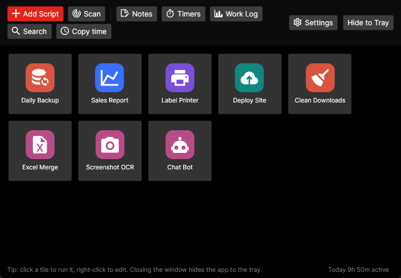
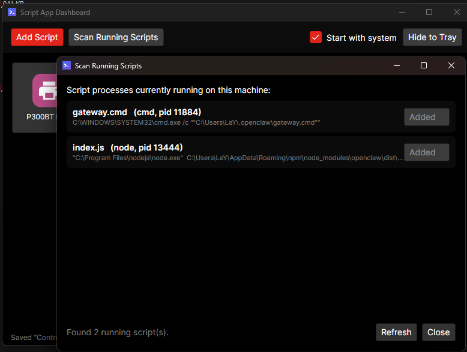
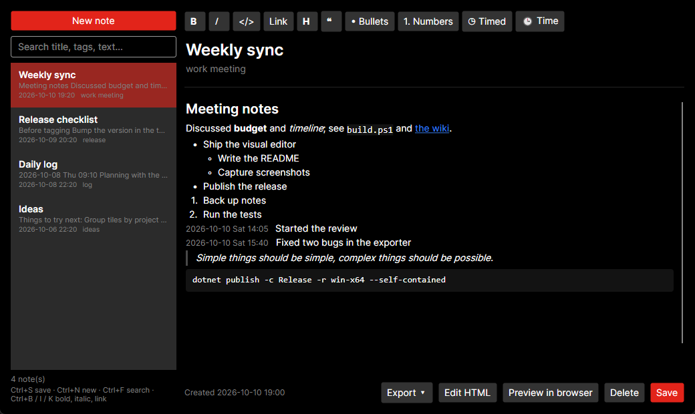
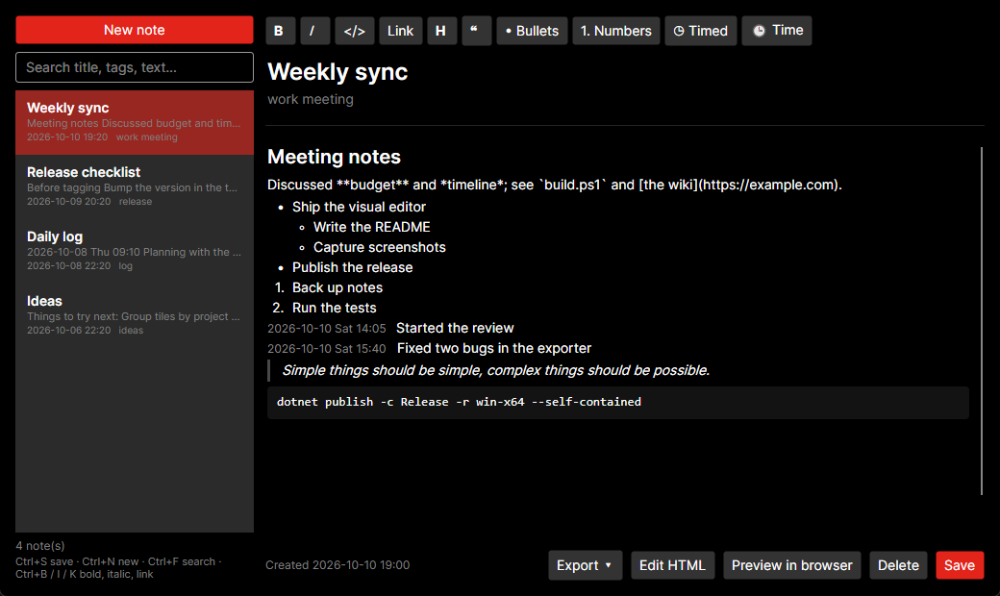
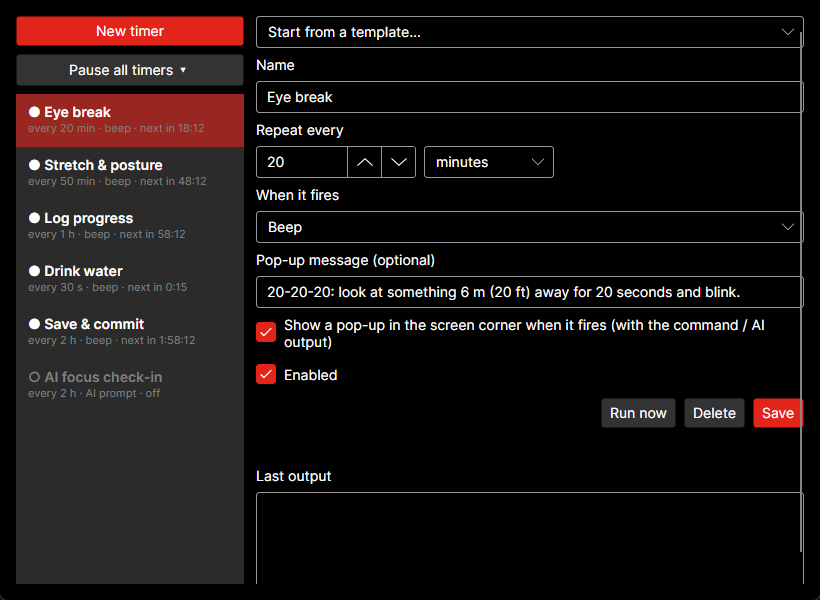
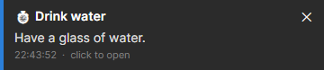
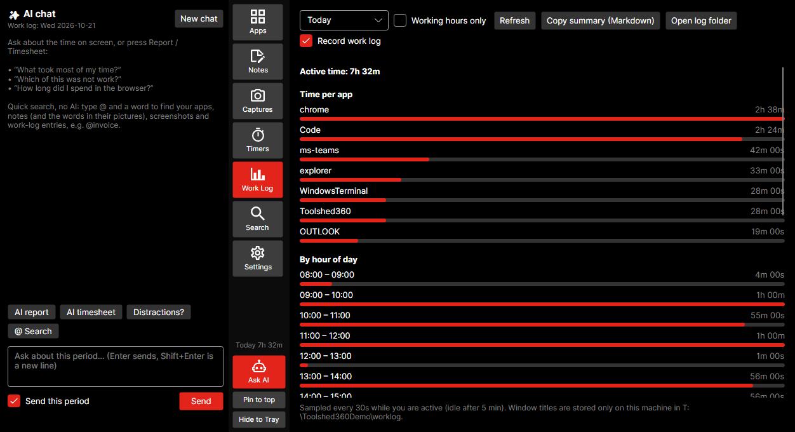
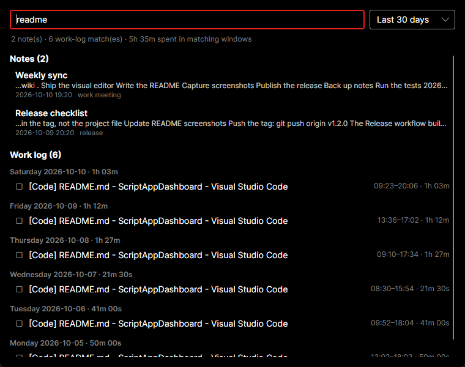
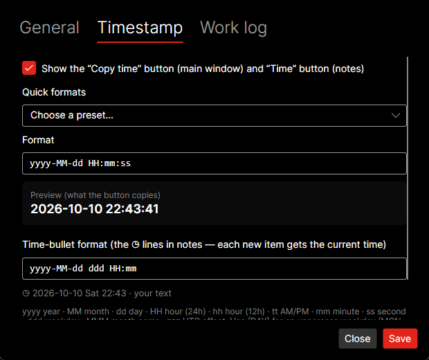

# Script App Dashboard

A small cross-platform (Windows / macOS) desktop app for the people who live in scripts. It launches all your Python tools, shell scripts and utilities from one dashboard, and it also keeps quick notes, runs interval timers and logs where your working time goes. Built with .NET 8 and Avalonia UI.



## Features

### Dashboard

- **Tile dashboard:** every script is a clickable tile. Click to run; right-click to Run, Edit, Open Containing Folder or Remove.
- **Custom icon, path and parameters:** each tile has a name, script path, command-line parameters, working directory and an optional icon. Pick one of 7,000+ searchable **Material Design Icons** (Apache 2.0, via the MIT-licensed `Material.Icons.Avalonia` package) or use your own .png / .jpg / .ico. Without an icon, a coloured initials tile is generated.
- **Interpreter support:** detected from the extension (`.py`, `.ps1`, `.sh`, `.js`, `.bat`/`.cmd`, `.exe`). You can also pick one explicitly, including a *custom command* such as a venv's `python.exe -u`.
- **Scan running scripts and apps:** finds scripts that are already running (python, node, powershell, bash, …) and open apps, and adds them to the dashboard with one click, parameters included.
- **Hide to tray:** closing the window hides the app to the system tray or menu bar. The tray menu lists your scripts, so you can launch them without opening the window.
- **Start with the system:** one checkbox registers auto-start. It uses the `HKCU\...\Run` registry key on Windows and a `~/Library/LaunchAgents` plist on macOS. The app starts hidden in the tray (`--minimized`).
- **Keep console open:** an optional per-script setting. It wraps the run in `cmd /k` on Windows, or a Terminal `.command` file on macOS, so you can read the output after the script finishes.



### Notes with a visual editor

Write notes the way you would in a word processor. Headings, **bold**, *italic*, links, lists and code show formatted as you type. Only the line you are editing shows its formatting marks, Obsidian-style, so you can still fix them by hand.



- **Toolbar:**
  - Bold (Ctrl+B), Italic (Ctrl+I), Link (Ctrl+K) and inline code.
  - Headings (click H again for a smaller one), quote, bulleted and numbered lists.
  - **Time bullets:** each new item is stamped with the current date and time when you press Enter. Handy for a running work log.
- **Markdown shortcuts at the start of a line:**
  - `- ` for a bullet and `1. ` for a numbered item.
  - `# ` / `## ` / `### ` for headings.
  - `> ` for a quote, ```` ``` ```` for a code block and `---` for a divider.
- **Keyboard:**
  - Enter continues a list, and Enter on an empty item ends it.
  - Tab / Shift+Tab indents and outdents list items.
  - Backspace at the start of a line joins it to the line above.
  - The arrow keys move between lines.
  - Pasting several lines creates one block per line, and list and heading prefixes are recognised.
- **Links:** Ctrl+click a link to open it.
- **Pictures:** paste a screenshot (Ctrl+V), drop picture files onto the note, or use the **🖼 Image** button. Pictures are shown in the note at full width; double-click one to open it, or right-click to remove it. They are kept as files in an `images` folder next to the notes, so notes stay small and sync quickly.
- **Tables:** the **▦ Table** button adds a table. Tab moves to the next cell (and adds a row at the end), Enter goes down a row, and right-clicking adds or removes rows and columns or turns the header row on or off. Cells take **bold**, *italic*, `code` and links like any other text. Pasting cells copied from Excel (or a Markdown table) makes a table; pasting them into a cell fills the table from there.
- **Charts:** the **📊 Chart** button adds a bar, line or pie chart drawn from a small data table: labels in the first column, one series per column. **Edit data** shows the numbers, the type box switches between bar, line and pie, and hovering shows the values. Right-click a table → **Make a chart from this table**. AI answers can include charts too, as a ```` ```chart ```` block holding CSV or a Markdown table.
- **Edit HTML:** notes are stored as clean HTML. **Edit HTML** shows the source; anything the visual editor can't represent, such as styled elements or tables with merged cells, is kept as an HTML block.
- **Search and tags:** search by title, tags or text. Ctrl+S saves, Ctrl+N starts a new note, Ctrl+F searches.
- **Export:** export one note or all matching notes as Markdown, export a note as a standalone HTML file (pictures and charts embedded, each chart with its data underneath), or preview it in the browser.

The paragraph being edited shows its formatting marks:



### Interval timers

Repeat a reminder every 30 seconds to every few hours. A timer can:

- beep,
- run a shell command, or
- send a prompt to the AI (see [AI](#ai)). The prompt can include `{today_summary}`, `{week_summary}`, `{current_app}`, `{clipboard}`, `{today_notes}`, `{date}` and `{time}`, which are filled in when the timer fires.

A small pop-up in the screen corner shows your message and the output. It doesn't steal focus and closes by itself. You can pause all timers from the window or the tray for 30 minutes, 1 hour, 2 hours, until tomorrow morning or until you resume. Templates get you started with an eye break, a stretch reminder, an AI check-in or a scheduled command. You can also describe a timer in a sentence ("remind me to drink water every 40 minutes") and press **Create with AI** to have it filled in for you.





### Work log

When turned on, the app records which window you work in about every 30 seconds:

- the app and window title, such as the browser tab or the file in your editor,
- scripts you launch from the dashboard,
- timer runs and new notes.

Idle time (5 minutes without input by default) and the lock screen are not counted. The Work Log window shows time per app, per window or browser tab, per hour of the day and per day for today, the last 7 days or the last 30 days. You can limit it to your working hours (for example 09:00–18:00, Mon–Fri; night shifts are supported) and copy the summary as Markdown. The status bar shows today's active time.



Everything stays on your machine, in daily JSON-lines files.

### Search everything

One search box (Ctrl+F in the main window) looks through notes and the work log together. Results are grouped by day, with the time spent in matching windows.



### Copy time

Many tasks need the current time pasted into a file or a ticket. **Copy time** in the main window or the tray copies it in your chosen format. Use a .NET date format or a template such as `[{yyyy-MM-dd HH:mm}]`, and pick a preset from Settings. The same format is used by the **Time** button in notes, and the button can be switched off.



### AI

The AI features run the [Claude Code](https://docs.claude.com/en/docs/claude-code) CLI in print mode (`claude -p`). The prompt goes to its standard input and its text answer is shown. Install it with `npm install -g @anthropic-ai/claude-code` and sign in once by running `claude` in a terminal. In **Settings → AI** you can:

- pick the model (Haiku 5.5 by default: fastest and cheapest; Sonnet, Opus or Fable for better writing),
- choose the language answers are written in,
- or use a custom command that reads a prompt on stdin, such as `ollama run llama3`.

Kiro is listed as a provider and will be supported in a later version. The **Test** button checks that everything works.

- **Ask AI**: a quick question from the main window, the tray, or the global hotkey `Ctrl+Alt+Space` (Windows; set it in Settings). Follow-up questions see the earlier ones. You can include the clipboard or the window you were working in, and save the answer as a note.
- **Notes**: the **✨ AI** menu improves, shortens, fixes or translates the selected text, or the whole note when nothing is selected. It can also continue writing, summarise the note, extract to-dos, turn raw meeting notes into minutes, and suggest a title and tags. You see the answer first and choose whether to replace, insert or save it as a new note. A note saved without a title gets an AI title and tags automatically.
- **Work log**: **AI report** writes a standup-style summary of the range on screen (what you worked on, where your focus went, what's next). **AI timesheet** groups the time into projects with hours. Either can be saved as a note. When working hours end, an AI summary of the day is written into a note.
- **Scripts**: right-click a tile and choose **Explain with AI…** to see what a script does and anything risky before you run it. **AI Script** writes a new script from a description; you review it before it's saved and added as a tile.

Nothing is sent to the AI unless you use one of these features, set up an AI timer, or leave the automatic title and day summary turned on. Both can be switched off in Settings → AI.

## Run

```
dotnet run
```

## Publish a self-contained app

```
# Windows
dotnet publish -c Release -r win-x64 --self-contained -p:PublishSingleFile=true

# macOS (Apple Silicon / Intel)
dotnet publish -c Release -r osx-arm64 --self-contained
dotnet publish -c Release -r osx-x64 --self-contained
```

The output lands in `bin/Release/net8.0/<rid>/publish/`. Turn on "Start with the system" only **after** moving the app to its final location, because the registered path is the path of the running executable.

## Download

Ready-made builds for Windows (x64) and macOS (Intel and Apple Silicon) are on the [Releases](https://github.com/leybme/ScriptAppDashboard/releases) page.

- Unzip and run `ScriptAppDashboard.exe` (Windows) or `ScriptAppDashboard` (macOS). No installation is needed.
- The binaries are unsigned:
  - On Windows, SmartScreen may warn the first time. Choose "More info → Run anyway".
  - On macOS, Gatekeeper warns on first launch. Right-click → Open, or run `xattr -d com.apple.quarantine ScriptAppDashboard`.

## CI and automated releases

GitHub Actions workflows live in `.github/workflows/`:

- **CI** (`ci.yml`): every push to `main` and every pull request builds the app in Release mode on Windows and macOS runners.
- **Release** (`release.yml`): pushing a version tag builds self-contained single-file binaries for `win-x64`, `osx-x64` and `osx-arm64`. It zips them and publishes a GitHub Release with auto-generated notes and the three zips attached. The tag, minus the `v`, becomes the assembly version.

To cut a release:

```
git tag v1.2.0
git push origin v1.2.0
```

The pull request template in `.github/PULL_REQUEST_TEMPLATE.md` pre-fills every new PR with a summary, test and checklist structure.

## Where your data lives

- **Settings folder (this PC):** settings and scripts are stored in:
  - `%APPDATA%\ScriptAppDashboard` on Windows,
  - `~/Library/Application Support/ScriptAppDashboard` on macOS.
- **Data folder:** notes, pictures and the work log. By default it is the same folder. Settings → General shows both and has **Open** buttons.
- **Files in the data folder:**
  - `notes/<id>.json`: one file per note. Older versions kept every note in one `notes.json`; it is split up automatically the first time, and the old file is kept as `notes.json.migrated`.
  - `images/`: pictures used in notes.
  - `worklog/yyyy-MM-dd.jsonl`: the work log, one JSON object per line (`yyyy-MM-dd.<PC name>.jsonl` in a synced folder).
  - `timers.json`: the interval timers, when you share them between PCs.
- **Using another folder:** set the `SCRIPTAPPDASHBOARD_DATA` environment variable to keep the settings elsewhere, for a portable install or a demo.

### Sync between PCs with OneDrive

In **Settings → General**, press **Use OneDrive** (or **Choose folder…** for Dropbox, Google Drive or any synced folder) and **Save**. Your notes, pictures and work log are copied there and the app restarts. Do the same on your other PCs.

- **Notes** are one file each, so two PCs only clash when both change the same note. Changes from another PC appear in the open notes window within seconds. If you were editing that same note, nothing is lost: the other version is kept as a separate "(conflicting copy)" note. A conflict copy made by OneDrive itself is handled the same way.
- **The work log**: each PC writes its own files, and the Work Log window and AI reports add up the time from all of them.
- **Settings and scripts** stay on each PC, because script paths differ between machines. Tick **Share the interval timers** to give every PC the same timers.
- Window titles from the work log are then stored in your cloud folder. Leave the data folder on **Only this PC** if you don't want that.

## Notes

- Interpreters are found on `PATH` (`python`, `node`, `bash`, …). If a script fails to launch, set an explicit interpreter or a custom command in its Edit dialog.
- The process scan uses `Get-CimInstance Win32_Process` on Windows and `ps -axo pid,args` on macOS. It doesn't need elevated rights for your own processes.
- Window-title logging uses Win32 APIs, so the work log records foreground windows on Windows only. The rest of the app works on both platforms.

## License

Script App Dashboard is source-available under the [PolyForm Noncommercial License 1.0.0](LICENSE.md).

- **Free:** personal use, such as your own PC, hobby projects, study or testing. Charities, schools, public research and government bodies may use it for free too. You may change the code for these uses.
- **Needs a commercial license:** using it in or for a company, or any other commercial use, including selling or reselling the app or a modified version of it.

For a commercial license, contact [@leybme](https://github.com/leybme). The bundled third-party packages (Avalonia, Material.Icons.Avalonia and others) keep their own licenses.

## Author

**Y Nguyen** ([@leybme](https://github.com/leybme))
