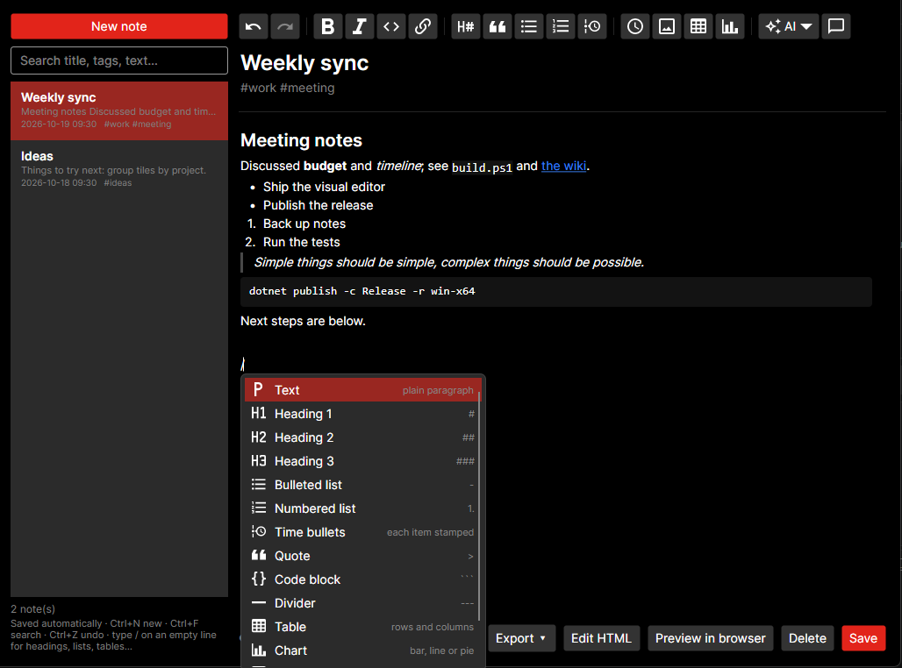
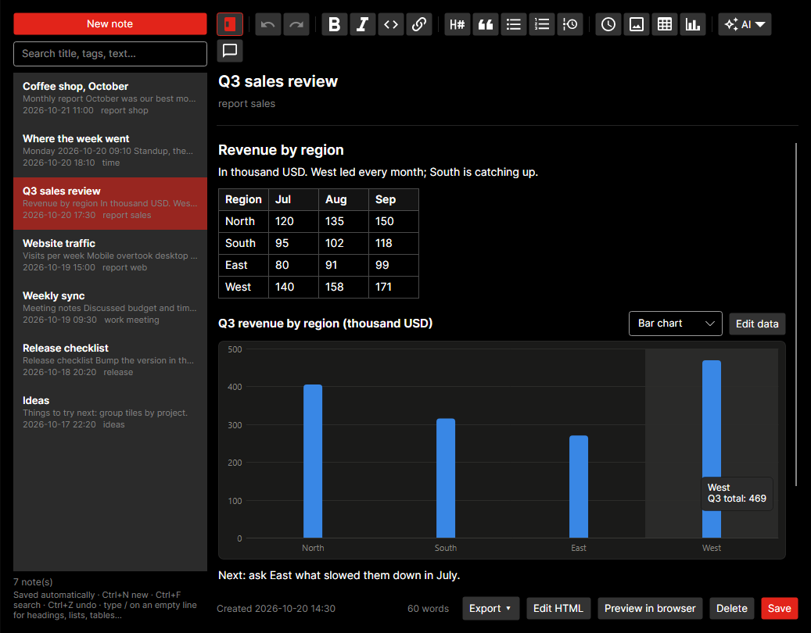
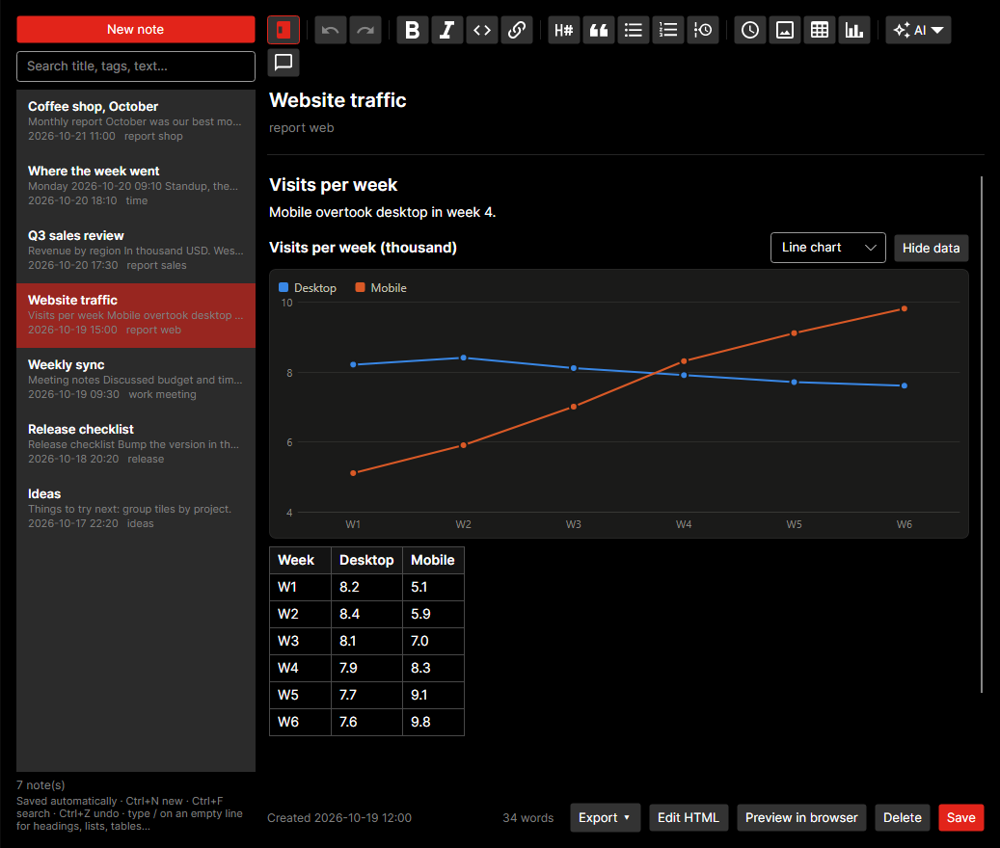
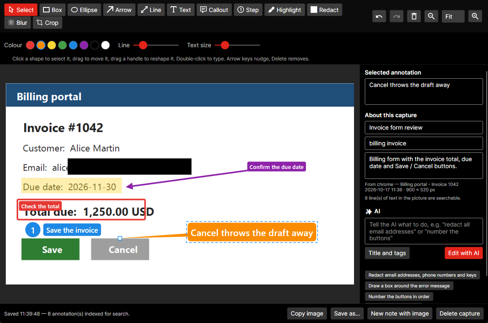
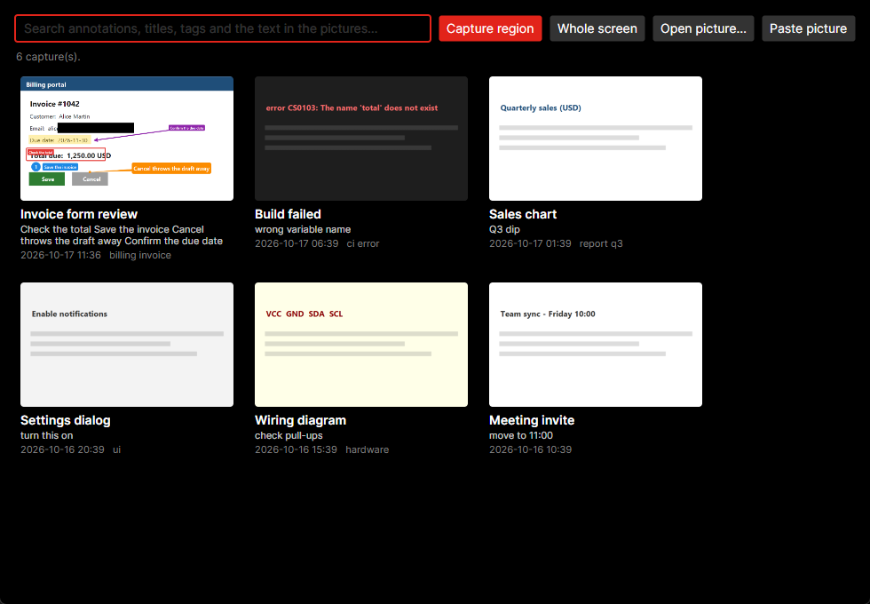
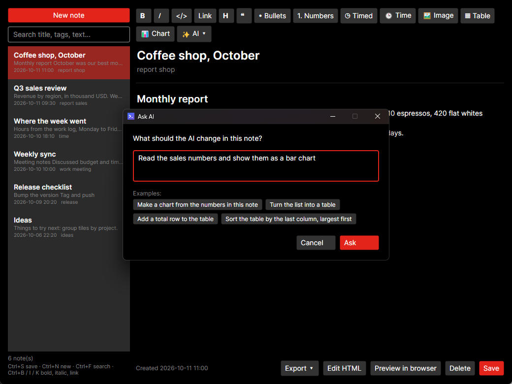
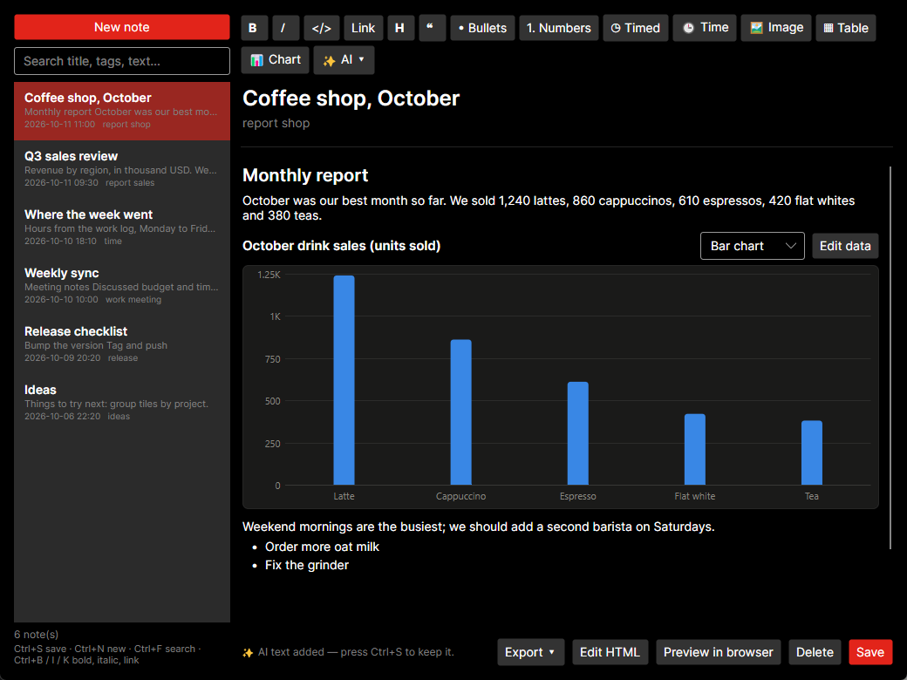

# Toolshed360

*Toolshed360 was called "Script App Dashboard" before. On first start it moves your old settings folder over and updates the auto-start entry, so nothing is lost.*

A small cross-platform (Windows / macOS) desktop app for the people who live in scripts. It launches all your Python tools, shell scripts and utilities from one dashboard, and it also keeps quick notes, runs interval timers and logs where your working time goes. Built with .NET 8 and Avalonia UI.


## Features

### Dashboard

- **Tile dashboard:** every script is a clickable tile. Click to run; right-click to Run, Edit, Open Containing Folder or Remove.
- **Custom icon, path and parameters:** each tile has a name, script path, command-line parameters, working directory and an optional icon. Pick one of 7,000+ searchable **Material Design Icons** (Apache 2.0, via the MIT-licensed `Material.Icons.Avalonia` package) or use your own .png / .jpg / .ico. Without an icon, a coloured initials tile is generated.
- **Interpreter support:** detected from the extension (`.py`, `.ps1`, `.sh`, `.js`, `.bat`/`.cmd`, `.exe`). You can also pick one explicitly, including a *custom command* such as a venv's `python.exe -u`.
- **Scan running scripts and apps:** finds scripts that are already running (python, node, powershell, bash, …) and open apps, and adds them to the dashboard with one click, parameters included.
- **One window with tabs:** Apps, Notes, Captures, Timers, Work Log, Search and Settings are tabs in one window. The AI chat is on the left, the tab list next to it and the tab content on the right. The window starts compact, with just the chat and the tab list; click a tab to open its content (the window widens to the right), click the open tab again to collapse it. The window remembers how wide you made the content (also after a restart). You can also hide the chat with **Ask AI** (`Ctrl+J`); with both hidden the window becomes a slim floating dock of tab buttons (drag the handle at the top to move it), and clicking a tab or **Ask AI** brings the full window back. The screenshots below were taken before this layout and show each part as it was.
- **Light and dark theme:** **Settings → General → Theme** switches between following the system, dark and light, at once and without pressing Save.
- **One text size:** the interface uses a small set of sizes (11 for hints, 12 for secondary text, 13 for normal text, 15 for section headers); your notes use 14.
- **Pin to top:** the small **Pin to top** button above **Hide to Tray** keeps the window above all other windows (it turns red while pinned, and the choice is remembered).
- **Hide to tray:** closing the window hides the app to the system tray or menu bar. The tray menu lists your scripts, so you can launch them without opening the window.
- **Start with the system:** one checkbox registers auto-start. It uses the `HKCU\...\Run` registry key on Windows and a `~/Library/LaunchAgents` plist on macOS. The app starts hidden in the tray (`--minimized`).
- **Keep console open:** an optional per-script setting. It wraps the run in `cmd /k` on Windows, or a Terminal `.command` file on macOS, so you can read the output after the script finishes.


### Notes with a visual editor

Write notes the way you would in a word processor. Headings, **bold**, *italic*, links, lists and code show formatted as you type. Only the line you are editing shows its formatting marks, Obsidian-style, so you can still fix them by hand.


- **Toolbar** (one row of icons; hover one for its name and shortcut):
  - Hide or show the note list, so the note gets the whole width (remembered; Ctrl+F shows it again to search). While it is hidden, a **New note** button sits next to it.
  - Undo and redo.
  - Bold (Ctrl+B), Italic (Ctrl+I), inline code and Link (Ctrl+K).
  - Headings (click again for a smaller one), quote, bulleted and numbered lists, and time bullets. The button of the line you are in is highlighted, and the heading button shows its level (H1, H2, H3).
  - **Time bullets:** each new item is stamped with the current date and time when you press Enter. Handy for a running work log.
  - Insert the time, a picture, a table or a chart, and the **AI** menu and chat.
- **`/` menu:** type `/` on an empty line to pick what the line becomes: text, heading 1–3, bulleted, numbered or time list, quote, code block, divider, table, chart, picture, or the date and time. Keep typing to filter (`/h2`, `/tab`), use the arrow keys and Enter, or click; Escape closes it.

  
- **Undo:** Ctrl+Z / Ctrl+Y (or Ctrl+Shift+Z) undo and redo everything in the note, not just the typing in one line: new and joined lines, deleted blocks (even after Ctrl+A, Delete), tables, pictures, and changes the AI applied. Quick typing in one line is one step.
- **Saving:** notes save themselves a few seconds after you stop typing, and when you switch notes or tabs. Ctrl+S saves at once.
- **Markdown shortcuts at the start of a line:**
  - `- ` for a bullet and `1. ` for a numbered item.
  - `# ` / `## ` / `### ` for headings.
  - `> ` for a quote, ```` ``` ```` for a code block and `---` for a divider.
- **Keyboard:**
  - Enter continues a list, and Enter on an empty item ends it.
  - Tab / Shift+Tab indents and outdents list items.
  - Backspace at the start of a line joins it to the line above.
  - The arrow keys move between lines, and Up / Down also move between the title, the tags and the note.
  - Pasting several lines creates one block per line, and list and heading prefixes are recognised.
- **Links:** Ctrl+click a link to open it.
- **Pictures:** paste a screenshot (Ctrl+V), drop picture files onto the note, or use the picture button (or `/picture`). Pictures are shown in the note at full width; double-click one to open it, or right-click to remove it. They are kept as files in an `images` folder next to the notes, so notes stay small and sync quickly.
- **Tables:** the table button (or `/table`) adds a table. Tab moves to the next cell (and adds a row at the end), Enter goes down a row, and right-clicking adds or removes rows and columns or turns the header row on or off. Cells take **bold**, *italic*, `code` and links like any other text. Pasting cells copied from Excel (or a Markdown table) makes a table; pasting them into a cell fills the table from there.
- **Charts:** the chart button (or `/chart`) adds a bar, line or pie chart drawn from a small data table: labels in the first column, one series per column. **Edit data** shows the numbers, the type box switches between bar, line and pie, and hovering shows the values. Right-click a table → **Make a chart from this table**. AI answers can include charts too, as a ```` ```chart ```` block holding CSV or a Markdown table.
- **Edit HTML:** notes are stored as clean HTML. **Edit HTML** shows the source; anything the visual editor can't represent, such as styled elements or tables with merged cells, is kept as an HTML block.
- **Search and tags:** search by title, tags or text. Ctrl+N starts a new note, Ctrl+F searches. The word count is shown under the note.
- **Export:** export one note or all matching notes as Markdown, export a note as a standalone HTML file (pictures and charts embedded, each chart with its data underneath), or preview it in the browser.

The paragraph being edited shows its formatting marks:


Tables and charts sit in the note like any other block. Hover a chart to see the values of a column or slice:



**Edit data** opens the numbers a chart is drawn from; change them and the chart redraws:



### Interval timers

Repeat a reminder every 30 seconds to every few hours. A timer can:

- beep,
- run a shell command, or
- send a prompt to the AI (see [AI](#ai)). The prompt can include `{today_summary}`, `{week_summary}`, `{current_app}`, `{clipboard}`, `{today_notes}`, `{date}` and `{time}`, which are filled in when the timer fires.

Instead of repeating every N minutes, a timer can run at fixed times with a **cron expression** (minute, hour, day of month, month, day of week, local time): `0 9 * * 1-5` is weekdays at 09:00, `*/15 * * * *` every 15 minutes, `@daily` midnight. The editor shows the next three run times. Cron timers only run while Toolshed360 is running; a run missed while the PC slept or timers were paused is skipped, not run late.

A small pop-up in the screen corner shows your message and the output. It doesn't steal focus and closes by itself. You can pause all timers from the window or the tray for 30 minutes, 1 hour, 2 hours, until tomorrow morning or until you resume. Templates get you started with an eye break, a stretch reminder, an AI check-in or a scheduled command. To have the AI set one up, ask in the chat beside the timers ("remind me to drink water every 40 minutes", "every weekday at 9:30 ask AI what to focus on"): under its answer, **Load into editor** puts the timer in the form for you to check and save.


### Work log

When turned on, the app records which window you work in about every 30 seconds:

- the app and window title, such as the browser tab or the file in your editor,
- scripts you launch from the dashboard,
- timer runs and new notes.

Idle time (5 minutes without input by default) and the lock screen are not counted. The Work Log window shows time per app, per window or browser tab, per hour of the day and per day for today, the last 7 days or the last 30 days. You can limit it to your working hours (for example 09:00–18:00, Mon–Fri; night shifts are supported) and copy the summary as Markdown. The status bar shows today's active time.


Everything stays on your machine, in daily JSON-lines files.

### Search everything

One search box (the Search tab, or Ctrl+F) looks through your apps, notes, screenshots and the work log together. **Apps** are the tiles of the dashboard (name, file, arguments, interpreter); click a result to run it. **Notes** match on their title, tags and text, and also on the words found in their pictures (the result then says "in a picture"); screenshots match on their annotations, title, tags, description, source window and the words found in the picture. The words in pictures are read in the background (Windows), a few at a time while you are away from the keyboard. Work-log results are grouped by day, with the time spent in matching windows.

**Quick search from the chat:** type `@` and a word in the chat box (for example `@invoice`) and press Enter. The apps, notes, screenshots and work-log entries that match appear in the chat as rows, with no AI and no tab needed; click an app to run it, a note or a screenshot to open it, or **Open in Search tab** to see everything. The **@ Search** quick button starts it for you.


### Screenshots with annotations

Press `Ctrl+Alt+C` anywhere (Windows; change it in **Settings → Capture**), or use **Captures** in the tray or main window. The screen freezes: drag a region, click the outlined window to take it, press `F` for everything, `Esc` to cancel. The picture opens in an editor, like Snagit:

- **Tools**: box, ellipse, arrow, line, text, callout (a speech box pointing at an anchor), numbered step, highlight, **redact** (solid cover), **blur** (mosaic) and crop. Pick a colour, line width and text size; drag shapes to move them, drag the handles to reshape them, `Shift` keeps lines at 45° and boxes square. Undo and redo cover everything.
- **Words are searchable**: type text on any annotation, then add a title, tags and a description. Everything is saved automatically, and the original picture is never changed (except by crop), so annotations stay editable.
- **Text in the picture** is read with the Windows OCR and indexed too, so you can find a screenshot by what is written in it. Turn it off in Settings → Capture.
- **Find them again**: the **Captures** window shows a thumbnail grid with its own search, and the main search (`Ctrl+F`) lists captures with the matching words.
- **Use them**: copy the annotated picture, save it as a PNG, or make a new note holding the picture and its annotation words. You can also annotate a picture file or the picture on the clipboard.
- **AI**: tell the AI what to do (“redact all email addresses”, “number the buttons”, “box the error message”). The AI reads text only, so it gets the OCR text with positions and the current annotations, and answers with changes; **Ctrl+Z** undoes them. **Title and tags** suggests a title, tags and a description from the text, and a capture saved without a title gets one automatically.





### Copy time

Many tasks need the current time pasted into a file or a ticket. **Copy time** in the main window or the tray copies it in your chosen format. Use a .NET date format or a template such as `[{yyyy-MM-dd HH:mm}]`, and pick a preset from Settings. The same format is used by the **Time** button in notes, and the button can be switched off.


### AI

The AI features run the [Claude Code](https://docs.claude.com/en/docs/claude-code) CLI in print mode (`claude -p`, started without tools or MCP servers so answers come back quickly). The prompt goes to its standard input and its text answer is shown. Install it with `npm install -g @anthropic-ai/claude-code` and sign in once by running `claude` in a terminal. In **Settings → AI** you can:

- pick the model (Haiku 5.5 by default: fastest and cheapest; Sonnet, Opus or Fable for better writing),
- choose the language answers are written in,
- or use a custom command that reads a prompt on stdin, such as `ollama run llama3`.

Kiro is listed as a provider and will be supported in a later version. The **Test** button checks that everything works.

- **Ask AI**: a quick question from the main window, the tray, or the global hotkey `Ctrl+Alt+Space` (Windows; set it in Settings). Follow-up questions see the earlier ones. You can include the clipboard or the window you were working in, and save the answer as a note.
- **Notes**: the **✨ AI** menu improves, shortens, fixes or translates the selected text, or the whole note when nothing is selected. It can also continue writing, summarise the note, extract to-dos, turn raw meeting notes into minutes, and suggest a title and tags. The answers appear in the **AI chat** beside the note, where you choose whether to replace, insert or save them as a new note. A note saved without a title gets an AI title and tags automatically.
- **Learning English**: right-click a word in a note (it is picked for you) or select a sentence first. **🔊 Speak** reads it aloud (or the whole paragraph when nothing is selected; **🔉 Speak slowly** is slower) using the system voice. **✨ Explain (for learning English)** gives the meaning, pronunciation, examples and a translation into your AI answer language (the answer appears formatted in the AI chat, with **Insert below**, **Copy** and **🔊 Speak** buttons), and the same menu has Ask AI, Translate and the other rewrites.
- **AI chat**: the chat panel is on the left of the window and open when the app starts (`Ctrl+J` or **Ask AI** hides and shows it). On the Notes tab, ask a question about the note, or tell the AI what to change in your own words, such as "read the sales numbers and show them as a bar chart", "turn the list into a table" or "add a total row". A question gets an answer you can insert below the paragraph you were in, use to replace the selected text, copy, speak or save as a new note. A change is shown first (**N changes**, expandable); nothing happens to the note until you press **Apply**, and **Undo** puts it back. The AI changes only the parts it needs to. Selected text is sent as context (shown above the message box), and untick **Send the note** to chat without sharing it. Each note has its own conversation, kept until the app quits. The **✨ AI** menu's actions (and **Ask AI to change the note…**) use the same panel.
- **One chat for every tab**: the chat follows the tab in front (Apps, Notes, Captures, Timers, Work Log, Search, Settings). A line under its title says what the AI is looking at ("Work log: Mon 2026-10-19", "Apps: 12 scripts"), and the box above **Send** lets you chat without sharing it. Outside the notes the AI only answers; it never changes anything. Each tab has its own conversation and quick buttons above the message box, and several tabs can wait for an answer at the same time. Answers appear as they are written, already formatted (headings, bold and italic, lists, tables, code blocks, links), with a seconds counter while the AI starts. The chat only follows the new text while you are at the bottom, so you can scroll up and read. While the chat is open the app keeps an AI process ready in the background, so a question starts answering within about a second or two. Answers can be copied, spoken or saved as a note.
- **Work log**: on the Work Log tab, the chat's **AI report** button writes a standup-style summary of the range on screen (what you worked on, where your focus went, what's next), and **AI timesheet** groups the time into projects with hours. Both answers appear in the chat with a **Save as note** button. When working hours end, an AI summary of the day is written into a note.
- **Scripts**: right-click a tile and choose **Explain with AI…** to see what a script does and anything risky before you run it; the answer appears in the dashboard's chat panel. **AI Script** writes a new script from a description; you review it before it's saved and added as a tile.
- **Timers**: ask the chat for a cron expression or a command, and it sees your timers and the one in the editor.



The answer is shown first. **Apply to the note** puts the chart right after the sentence with the numbers:



Nothing is sent to the AI unless you use one of these features, set up an AI timer, or leave the automatic title and day summary turned on. Both can be switched off in Settings → AI.

## Run

```
dotnet run
```

## Publish a self-contained app

```
# Windows
dotnet publish -c Release -r win-x64 --self-contained -p:PublishSingleFile=true

# macOS (Apple Silicon / Intel)
dotnet publish -c Release -r osx-arm64 --self-contained
dotnet publish -c Release -r osx-x64 --self-contained
```

The output lands in `bin/Release/net8.0/<rid>/publish/`. Turn on "Start with the system" only **after** moving the app to its final location, because the registered path is the path of the running executable.

## Download

Ready-made builds for Windows (x64) and macOS (Intel and Apple Silicon) are on the [Releases](https://github.com/leybme/ScriptAppDashboard/releases) page.

- Unzip and run `Toolshed360.exe` (Windows) or `Toolshed360` (macOS). No installation is needed.
- The binaries are unsigned:
  - On Windows, SmartScreen may warn the first time. Choose "More info → Run anyway".
  - On macOS, Gatekeeper warns on first launch. Right-click → Open, or run `xattr -d com.apple.quarantine Toolshed360`.

## CI and automated releases

GitHub Actions workflows live in `.github/workflows/`:

- **CI** (`ci.yml`): every push to `main` and every pull request builds the app in Release mode on Windows and macOS runners.
- **Release** (`release.yml`): pushing a version tag builds self-contained single-file binaries for `win-x64`, `osx-x64` and `osx-arm64`. It zips them and publishes a GitHub Release with auto-generated notes and the three zips attached. The tag, minus the `v`, becomes the assembly version.

To cut a release:

```
git tag v1.2.0
git push origin v1.2.0
```

The pull request template in `.github/PULL_REQUEST_TEMPLATE.md` pre-fills every new PR with a summary, test and checklist structure.

## Where your data lives

- **Settings folder (this PC):** settings and scripts are stored in:
  - `%APPDATA%\Toolshed360` on Windows,
  - `~/Library/Application Support/Toolshed360` on macOS.
- **Data folder:** notes, pictures and the work log. By default it is the same folder. Settings → General shows both and has **Open** buttons.
- **Files in the data folder:**
  - `notes/<id>.json`: one file per note. Older versions kept every note in one `notes.json`; it is split up automatically the first time, and the old file is kept as `notes.json.migrated`.
  - `images/`: pictures used in notes.
  - `captures/`: screenshots: `<id>.png` (untouched), `<id>.json` (annotations, title, tags, OCR text) and `<id>.annotated.png`.
  - `worklog/yyyy-MM-dd.jsonl`: the work log, one JSON object per line (`yyyy-MM-dd.<PC name>.jsonl` in a synced folder).
  - `timers.json`: the interval timers, when you share them between PCs.
- **Using another folder:** set the `TOOLSHED360_DATA` environment variable to keep the settings elsewhere, for a portable install or a demo.

### Sync between PCs with OneDrive

In **Settings → General**, press **Use OneDrive** (or **Choose folder…** for Dropbox, Google Drive or any synced folder) and **Save**. Your notes, pictures and work log are copied there and the app restarts. Do the same on your other PCs.

- **Notes** are one file each, so two PCs only clash when both change the same note. Changes from another PC appear in the open notes window within seconds. If you were editing that same note, nothing is lost: the other version is kept as a separate "(conflicting copy)" note. A conflict copy made by OneDrive itself is handled the same way.
- **The work log**: each PC writes its own files, and the Work Log window and AI reports add up the time from all of them.
- **Settings and scripts** stay on each PC, because script paths differ between machines. Tick **Share the interval timers** to give every PC the same timers.
- Window titles from the work log are then stored in your cloud folder. Leave the data folder on **Only this PC** if you don't want that.

## Notes

- Interpreters are found on `PATH` (`python`, `node`, `bash`, …). If a script fails to launch, set an explicit interpreter or a custom command in its Edit dialog.
- The process scan uses `Get-CimInstance Win32_Process` on Windows and `ps -axo pid,args` on macOS. It doesn't need elevated rights for your own processes.
- Window-title logging uses Win32 APIs, so the work log records foreground windows on Windows only. The rest of the app works on both platforms.

## License

Toolshed360 is source-available under the [PolyForm Noncommercial License 1.0.0](LICENSE.md).

- **Free:** personal use, such as your own PC, hobby projects, study or testing. Charities, schools, public research and government bodies may use it for free too. You may change the code for these uses.
- **Needs a commercial license:** using it in or for a company, or any other commercial use, including selling or reselling the app or a modified version of it.

For a commercial license, contact [@leybme](https://github.com/leybme). The bundled third-party packages (Avalonia, Material.Icons.Avalonia and others) keep their own licenses.

## Author

**Y Nguyen** ([@leybme](https://github.com/leybme))
